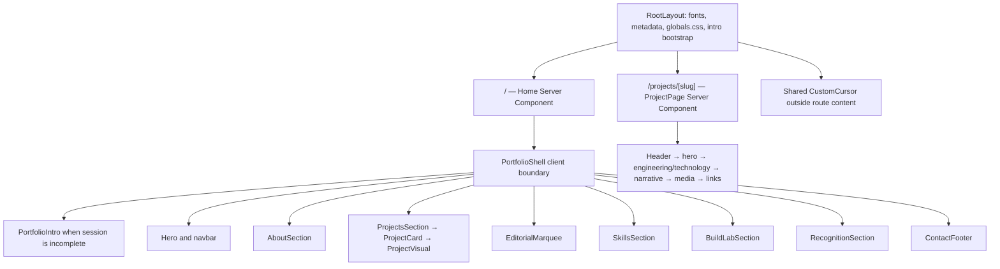
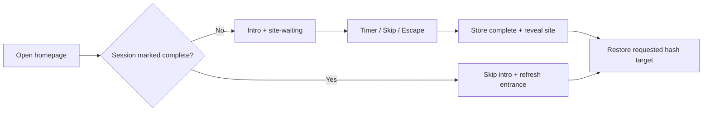
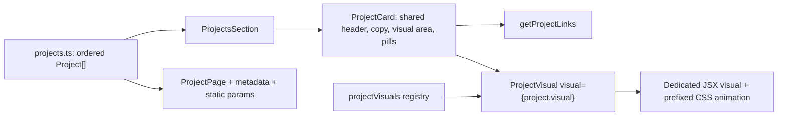

# Project architecture

Last source review: **2026-10-27**.

Start with [AGENTS.md](../AGENTS.md) for editing rules and [README.md](../README.md) for setup. This document describes the running Next.js application, not the internal implementations of the software projects featured in the portfolio. See [Design system](DESIGN-SYSTEM.md), [Components and pages](COMPONENTS-AND-PAGES.md), and [Project status](PROJECT-STATUS.md) for related guidance.

## Application boundaries

This is a personal portfolio built with Next.js App Router, React, TypeScript, CSS, and `motion/react`. Content is stored in local TypeScript data modules. The application presents a homepage, four project case studies, local screenshots, certificates, a résumé, and outbound links.

There is no portfolio API, database, authentication service, upload service, contact form submission handler, CMS, or model inference integration in the current `src/` tree. References to Supabase, Groq, Cloudflare Workers, Prisma, SQLite, and other services in project descriptions describe those separate projects. They are not live integrations or dependencies of this portfolio.

The introductory screen is a timed animation with session storage, not a password gate or access-control mechanism.

## Directory map

| Location | Responsibility |
| --- | --- |
| [`src/app/layout.tsx`](../src/app/layout.tsx) | Root HTML/body, font variables, metadata, global CSS import, shared custom cursor, homepage intro bootstrap script. |
| [`src/app/page.tsx`](../src/app/page.tsx) | Homepage Server Component; calculates the UTC year and renders `PortfolioShell`. |
| [`src/app/projects/[slug]/page.tsx`](../src/app/projects/%5Bslug%5D/page.tsx) | Shared project case-study Server Component, metadata, generated route parameters. |
| [`src/app/globals.css`](../src/app/globals.css) | Design tokens, all component styles, project animation keyframes, responsive and reduced-motion rules. |
| [`src/components/`](../src/components/) | Homepage sections, shared project card and visual registry, interaction components. |
| [`src/components/motion/`](../src/components/motion/) | `FadeIn` and `Magnetic` interaction helpers. |
| [`src/data/`](../src/data/) | Portfolio content, links, navigation, section visibility, skill/achievement/project data. |
| [`src/lib/portfolio-intro.ts`](../src/lib/portfolio-intro.ts) | Shared session-storage key for the intro. |
| [`public/`](../public/) | Served assets; code uses URLs relative to the public root. |
| [`next.config.ts`](../next.config.ts) | React strict mode enabled; development indicator disabled. |
| [`tsconfig.json`](../tsconfig.json) | Strict TypeScript, bundler resolution, `@/*` alias to `src/*`. |
| [`postcss.config.mjs`](../postcss.config.mjs) | Tailwind's PostCSS plugin. |
| [`eslint.config.mjs`](../eslint.config.mjs) | Next.js core web vitals and TypeScript lint configuration. |

Other repository material has a different role:

- [`src/components/journey-section.tsx`](../src/components/journey-section.tsx) and [`src/data/journey.ts`](../src/data/journey.ts) implement a timeline but are not imported by the current homepage shell.
- [`port.html`](../port.html) is a standalone older HTML portfolio, not an App Router route and not served from `public/`.
- [`mascot.png`](../mascot.png) at the repository root is not the asset requested by the application. The hero/footer use [`public/assets/mascot.png`](../public/assets/mascot.png).
- `Reference/` contains local visual reference images. It is ignored by Git and is not imported by the application; do not treat its presence on one checkout as a deployment requirement.
- `.next/`, `node_modules/`, and `*.tsbuildinfo` are generated or installed material, not source directories.
- The existing local `CLAUDE.md` delegates to `AGENTS.md` through `@AGENTS.md`. It is ignored and may be absent in another checkout; the handoff does not depend on it.

## Routing and rendering

| URL | Source | Behavior |
| --- | --- | --- |
| `/` | [`src/app/page.tsx`](../src/app/page.tsx) | Server entry renders the interactive `PortfolioShell` client boundary. |
| `/projects/quizloom` | Shared `[slug]` page plus `projects` data | Quizloom case study. |
| `/projects/autrix` | Shared `[slug]` page plus `projects` data | Autrix case study, charcoal theme and scoped gallery refinements. |
| `/projects/api-sentinel` | Shared `[slug]` page plus `projects` data | API Sentinel case study. |
| `/projects/filepilot` | Shared `[slug]` page plus `projects` data | FilePilot case study. |
| Unknown project slug | Shared `[slug]` page | `getProject()` returns no entry and the page calls `notFound()`. |

`generateStaticParams()` maps the current `projects` array to route slugs for build-time generation. The async page and `generateMetadata()` await `params: Promise<{ slug: string }>` before looking up the entry. There is no separate page file per project and no explicit `dynamicParams = false` setting.

The root layout is shared by homepage and case studies and mounts one persistent `CustomCursor` directly under `body`, outside route content. Case studies do **not** render `PortfolioShell`, its navbar, cinematic intro, or homepage footer. Their own header supplies a `Link` back to `/#work`, the name mark, and project numbering. There are no custom route-level loading, error, not-found, template, or page-transition components in the current source tree.

The homepage's section visibility flags control About, projects/marquee, Skills, Lab, Certificates, and Contact/Footer. Hero remains mounted by the shell; the shared cursor belongs to the root layout independently of these flags. Navigation is a separate array and does not automatically filter when a visibility flag is disabled.

## Intro lifecycle and navigation restoration

The shared key is `ankush-portfolio-intro`; the completed value is `complete`. It lives in `sessionStorage`, so the state belongs to the current browser tab's session. Storage failures fall back to playing/completing the animation.

1. `PortfolioShell` reads completion state using a lazy state initializer, with an SSR guard.
2. For a fresh session, it renders `PortfolioIntro` and gives the site the `site-waiting` class.
3. The intro auto-completes after 1750 ms, or 100 ms with reduced motion. Its Skip button or Escape key can complete it early. A ref prevents duplicate completion.
4. Completion writes session state and reveals the site. The overlay exits upward over 0.75 seconds, or fades over 0.12 seconds with reduced motion.
5. A returning session skips the overlay and uses `site-refreshing` for the initial hero entrance.
6. Once the intro is complete, `PortfolioShell` restores a URL hash target with `scrollIntoView`, temporarily using automatic rather than smooth scrolling.

The `beforeInteractive` script in the root layout only acts on `/` when completion is already stored. It marks the document, reveals `#portfolio-site`, removes the server-rendered intro node, and uses a `MutationObserver` if the site element has not arrived yet. The storage key, bootstrap, React state, and `.site-waiting`/`.site-ready` CSS are coordinated; changing only one can produce flashes or mismatched entry behavior.

The displayed `PORTFOLIO / 2026` in the intro is literal content. The footer year is passed from `new Date().getUTCFullYear()` in the homepage Server Component; there is no client timer updating it.

## Data ownership

| Module | Data | Main consumers |
| --- | --- | --- |
| [`src/data/site.ts`](../src/data/site.ts) | `siteConfig`, section visibility, navigation labels/hash URLs | Shell, Hero, footer navigation. Root metadata is separately declared in `layout.tsx`. |
| [`src/data/profile.ts`](../src/data/profile.ts) | Hero copy, role/location, introduction, education | Hero and About. |
| [`src/data/about.ts`](../src/data/about.ts) | Typed About cards, depth and CSS class identifiers | AboutSection. |
| [`src/data/projects.ts`](../src/data/projects.ts) | Project records, case study content, links and screenshot metadata | ProjectsSection, ProjectCard, ProjectPage. |
| [`src/data/skills.ts`](../src/data/skills.ts) | Skill groups and icon-bearing items | SkillsSection. |
| [`src/data/recognition.ts`](../src/data/recognition.ts) | Certificate cards and detail-dialog records | RecognitionSection. |
| [`src/data/socials.ts`](../src/data/socials.ts) | Email, GitHub, LinkedIn, optional résumé URL | Hero and ContactFooter. |
| [`src/data/journey.ts`](../src/data/journey.ts) | Timeline records | Currently unused JourneySection. |

There is no runtime content editing interface. Change content in these modules, and keep CSS-dependent identifiers such as `className`, icon mappings, visual IDs, and gallery slots consistent with their consumers.

## Project schema

[`src/data/projects.ts`](../src/data/projects.ts) imports `ProjectVisualId` as a **type-only** import from the visual registry. It exports `Project`, `ProjectCaseSection`, `ProjectLink`, `projects`, `getProject()`, and `getProjectLinks()`.

| `Project` field | Type / optionality | Meaning |
| --- | --- | --- |
| `number` | `string` | Explicit display number, currently `01`–`04`. Maintain when adding/reordering projects. |
| `slug` | `string` | Unique lookup/route key. |
| `title` | `string` | Card and case-study title; HUD reads it from this record. |
| `category` | `string` | Project category text. |
| `description` | `string` | Short description and case metadata description. |
| `secondaryDescription` | `string` | Supporting card/case-study description. |
| `technologies` | `string[]` | Homepage technology pills and default case-study Technology list. |
| `caseTechnologies` | optional `string[]` | Case-study-only Technology override. No current project sets it. |
| `github` | `string` | Required repository URL. |
| `githubLabel` | optional `"GitHub" \| "View source" \| "Private repository"` | Repository button label; defaults to `GitHub`. Autrix and FilePilot explicitly use `GitHub`. |
| `liveDemo` | optional `string` | Adds a Live demo link only when present. |
| `download` | optional `string` | Adds a Download for Windows link only when present. |
| `caseStudy` | `string` | Internal case-study link; convention is `/projects/${slug}`. |
| `visual` | `ProjectVisualId` | Registry key selecting the custom homepage illustration. |
| `engineering` | `string[]` | Case-study Engineering focus list. |
| `media` | media object array | Screenshot labels, sources, alt text, optional captions. |
| `mediaHeading` | optional `string` | Enables a screenshot showcase heading block. No current project sets it. |
| `mediaDescription` | optional `string` | Supporting copy for that optional heading. |
| `galleryType` | optional `"desktop" \| "mobile"` | Adds a gallery CSS modifier; individual slugs also have scoped CSS. |
| `caseSections` | optional `ProjectCaseSection[]` | Structured narrative grid. All four current projects provide sections. |
| `tone` | `"paper" \| "charcoal"` | Card/case-study theme modifier. Autrix uses `charcoal`; the others use `paper`. |

`ProjectCaseSection` contains `label: string`, `title: string`, `paragraphs: string[]`, and optional `items: string[]`. The renderer creates an article with a label, large heading, paragraph grid, and optional list. It is content data, not Markdown or HTML.

Each media record contains `label: string`, `src: string | null`, `alt: string`, and optional `caption: string`. A null source displays a numbered placeholder stating that a real screenshot is to be added; every current media record has a source. A caption creates an image frame plus a separate caption region. Images without captions use the direct fill-image branch.

`ProjectLink` contains `label` and `href`. Its label union includes Live demo, Download for Windows, GitHub, View source, Private repository, and Case study. `getProjectLinks()` returns, in order: optional live demo, optional download, required GitHub, required case study. It does not independently validate URL availability or permissions.

## Reusable project card and visual registry

`ProjectCard` accepts `project`, zero-based `index`, `totalProjects`, and a Motion `progress` value. It owns the common card composition. Do not duplicate the whole card to introduce a new project.

[`src/components/project-visuals.tsx`](../src/components/project-visuals.tsx) contains separate exported illustration components and a private `projectVisuals` object satisfying `Record<string, ComponentType>`. `ProjectVisualId` is `keyof typeof projectVisuals`; adding a registry key updates the allowed data type. `ProjectVisual` looks up the component and returns `null` if a runtime lookup has no result. Keep that fallback rather than substituting another project's animation.

| Key | Component | Illustration and animation ownership |
| --- | --- | --- |
| `quizloom` | `QuizloomVisual` | Room code, two player nodes, Q tile, answer choices; `.quizloom-*` CSS. Tile idles over 6.8 s and node/connection sequences loop over 9 s. |
| `autrix` | `AutrixVisual` | Vehicle input panel, scan, Qwen Vision processing, Audi R8 result; `.autrix-*` CSS, coordinated 8.4 s loops. |
| `apiSentinel` | `ApiSentinelVisual` | GET request, progress, 200 response/JSON, assertion pass; `.api-sentinel-*` CSS, 5.4 s loops. |
| `filepilot` | `FilePilotVisual` | Folder scan, file sort, exact duplicate, safe plan/Undo; `.filepilot-*` CSS, 6.4 s loops. |

These are local illustrative JSX/SVG/CSS compositions. They do not execute quizzes, recognize photographs, send API requests, scan user files, or call the featured applications. Each has `role="img"` and a descriptive accessible label. Lucide icons are used inside the illustrations.

### Stack and active indicator

`ProjectsSection` uses `useScroll({ target: showcaseRef, offset: ["start start", "end end"] })`. The section height is data-derived: `100 + max(1, N - 1) * 165` small-viewport-height units. Four projects currently produce `595svh` on the animated desktop path.

The first sheet is the base. For subsequent cards, `ProjectCard` maps that card's segment of shared progress from `translateY(104%)` to `0%`, raising z-index with array position. CSS keeps the stage sticky at `1rem`, with height `calc(100svh - 2rem)` and clipped rounded boundaries.

The floating HUD initializes to the first project. `useMotionValueEvent` computes a clamped `round(progress * (N - 1))` index and updates React state only when the index changes. This selects midpoint boundaries in the existing stack timeline; it is not an independent IntersectionObserver visibility measurement. Position, count, and title come from the array, so both forward and backward scrolling update the label. The HUD is a polite live status with an accessible project-position label.

At widths of 820 px and below, CSS converts the stack to normal vertical cards and hides the HUD. Reduced-motion mode also removes the sticky stack/transform behavior, displays full cards in document flow, and omits the HUD. Each illustration has additional stable reduced-motion rules. See [Design system](DESIGN-SYSTEM.md) before adjusting the shared stage or per-visual scales/offsets.

### Add a project safely

The extension boundary is one ordered data record plus a dedicated visual registered under its `visual` key. The shared card and dynamic route remain reusable. Follow the full [adding-project workflow](COMPONENTS-AND-PAGES.md#adding-a-project-safely) for implementation and validation. Gallery modifiers describe existing patterns; they do not infer arbitrary new image proportions, so a new arrangement may need narrowly scoped `.case-media-<slug>` CSS.

The current code assumes at least one project. Emptying the array is not a supported use case: the HUD reads a project title and the stack math expects a nonempty collection.

## Case-study gallery architecture

The shared page adds `.case-study-project-${slug}` to the main element and `.case-media-${slug}` to the gallery. Use those scoped hooks for changes that should affect only one case study.

- **Quizloom:** `galleryType: "desktop"`; a full-width lead screenshot and two smaller screenshots beneath. Its dedicated `.case-gallery-desktop` frame ratios and responsive overrides remain significant.
- **Autrix:** `galleryType: "mobile"` with scoped overrides. Desktop is three equal-width columns, max width `96rem`, with Audi R8 / Home / Toyota Fortuner in that data order. All media frames use `750 / 1600` and images use full-size `object-fit: contain`; the source image files are not cropped or stretched. Captions use a shared minimum height. There is no text introduction above the current gallery.
- **Autrix at 820 px and below:** Home occupies a centered first row, with Audi and Toyota beneath in two columns. At 600 px and below, cards stack Home first, then Audi and Toyota, with max gallery width `23rem`.
- **API Sentinel:** two-column screenshot grid with four cards; `.case-media-api-sentinel` cancels the generic third-item full-span rule.
- **FilePilot:** two-column screenshot grid with four cards, scoped `1535 / 827` frames and a similar third-item reset.

The broad `.case-media`, `.case-gallery-mobile`, `.case-gallery-desktop`, `slot-*`, caption, and responsive rules interact. Read the full cascade before adjusting an image fit. `next/image` uses `fill`, so parent positioning and frame dimensions are part of correctness. `sizes` has an Autrix-specific responsive branch. Do not fix portrait fitting by stretching screenshots or adding `cover` indiscriminately.

## Served asset inventory

Files in `public/` are addressed without the `public` prefix. All current project screenshot references resolve to files on disk. Directory capitalization and spaces are part of the URL and must be preserved on case-sensitive hosting.

| Asset group | Actual files under `public/` |
| --- | --- |
| Identity | [`favicon.svg`](../public/favicon.svg), [`assets/mascot.png`](../public/assets/mascot.png), [`Ankush-Resume.pdf`](../public/Ankush-Resume.pdf). |
| Quizloom | [`projects/Quizloom/home.png`](../public/projects/Quizloom/home.png), [`player-quiz.png`](../public/projects/Quizloom/player-quiz.png), [`host-result.png`](../public/projects/Quizloom/host-result.png). |
| Autrix | [`projects/Autrix/autrix-audi-r8.jpeg`](../public/projects/Autrix/autrix-audi-r8.jpeg), [`autrix-home.jpeg`](../public/projects/Autrix/autrix-home.jpeg), [`autrix-toyota-fortuner.jpeg`](../public/projects/Autrix/autrix-toyota-fortuner.jpeg). |
| API Sentinel | [`projects/API Sentinel/api-sentinel-workspace.png`](../public/projects/API%20Sentinel/api-sentinel-workspace.png), [`api-sentinel-assertions.png`](../public/projects/API%20Sentinel/api-sentinel-assertions.png), [`api-sentinel-history.png`](../public/projects/API%20Sentinel/api-sentinel-history.png), [`api-sentinel-collections.png`](../public/projects/API%20Sentinel/api-sentinel-collections.png). |
| FilePilot | [`projects/FilePilot/filepilot-dashboard.png`](../public/projects/FilePilot/filepilot-dashboard.png), [`filepilot-duplicates.png`](../public/projects/FilePilot/filepilot-duplicates.png), [`filepilot-organize.png`](../public/projects/FilePilot/filepilot-organize.png), [`filepilot-history.png`](../public/projects/FilePilot/filepilot-history.png). |
| Certificates | [`certificates/excel-5-srinivas.jpg`](../public/certificates/excel-5-srinivas.jpg), [`agnesia-2026.jpg`](../public/certificates/agnesia-2026.jpg), [`aaroha-2026.jpg`](../public/certificates/aaroha-2026.jpg). The last filename retains its old spelling even though displayed content says Aaroham. |

See [Project status](PROJECT-STATUS.md) for duplicate screenshot content detected during documentation review. File existence does not prove that each screenshot depicts a distinct state.

## Outbound links and external dependencies

| Project | Repository | Additional action |
| --- | --- | --- |
| Quizloom | [Ankush9740/quizloom](https://github.com/Ankush9740/quizloom) | [Live demo](https://quizloom-sigma.vercel.app/). |
| Autrix | [Ankush9740/Autrix](https://github.com/Ankush9740/Autrix) | No live demo/download configured. The GitHub label does not establish public repository access. |
| API Sentinel | [Ankush9740/api-sentinel](https://github.com/Ankush9740/api-sentinel) | [Live demo](https://api-sentinel-smoky.vercel.app). |
| FilePilot | [Ankush9740/FilePilot](https://github.com/Ankush9740/FilePilot) | [Windows release link](https://github.com/Ankush9740/FilePilot/releases/tag/v1.0.0), a release page rather than a bundled installer. |

ProjectCard renders HTTP(S)-prefixed links as anchors with `target="_blank"` and `rel="noopener noreferrer"`; internal project links use `next/link`. The case-study bottom action list reuses `getProjectLinks()` but renders only HTTP-prefixed URLs, so its own internal Case study link is filtered out. Optional links are omitted without placeholders.

Social URLs and the `mailto:` contact destination are sourced from `socials.ts`; the résumé is a local PDF. Fonts come from `next/font/google` (`Inter`, `Space_Grotesk`) and are exposed as CSS variables. There are no remote image hosts configured in `next.config.ts`.

The exact package declarations and lockfile are authoritative for dependency versions. Major application tools are Next.js 16, React 19, TypeScript 6, Tailwind 4/PostCSS, Motion, Lucide React, and React Icons. The dependency name is `motion`, with imports from `motion/react`, not a separate `framer-motion` package. The visual styling is primarily authored CSS in `globals.css`; Tailwind is imported/configured but there is no standalone Tailwind configuration file.

## Build and deployment boundaries

[`package.json`](../package.json) defines `dev` (`next dev`), `build` (`next build`), `start` (`next start`), `lint` (`eslint .`), and `typecheck` (`tsc --noEmit`). It defines no test script or engine/version-manager constraint. There is no automated test suite or CI workflow in the repository inspected for this handoff.

The current configuration uses Next.js's regular build/runtime model. It does not configure static export, custom rewrites/redirects, remote image patterns, a custom base path, or a deployment provider. The source can be built and served using the documented npm commands. Public routes/assets and Next image optimization must remain supported by the chosen hosting setup; do not assume that copying the source or an `out/` folder constitutes the current deployment workflow.

No hosting-specific configuration, production domain ownership, environment-variable template, or secret requirement was found in the application configuration. External project demos are links and do not verify where the portfolio itself is deployed. Production hosting/account settings and remote URL availability require a separate, explicitly scoped verification.

Read the relevant installed framework guide under `node_modules/next/dist/docs/` before changing framework APIs. `AGENTS.md` contains the generated Next.js warning block and must retain it. The installed Layouts and Pages guide confirms promise-based dynamic params; the Image Optimization guide explains public-root asset URLs and dimensioned/fill-image parents.
